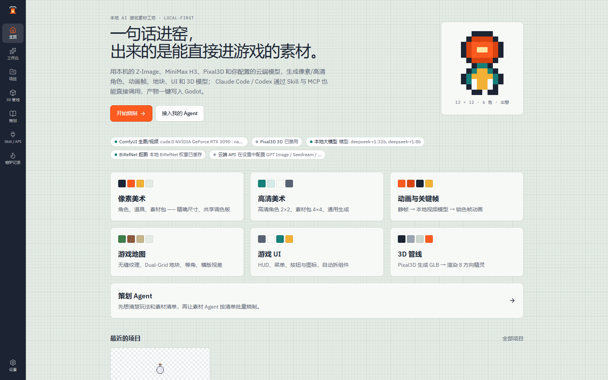
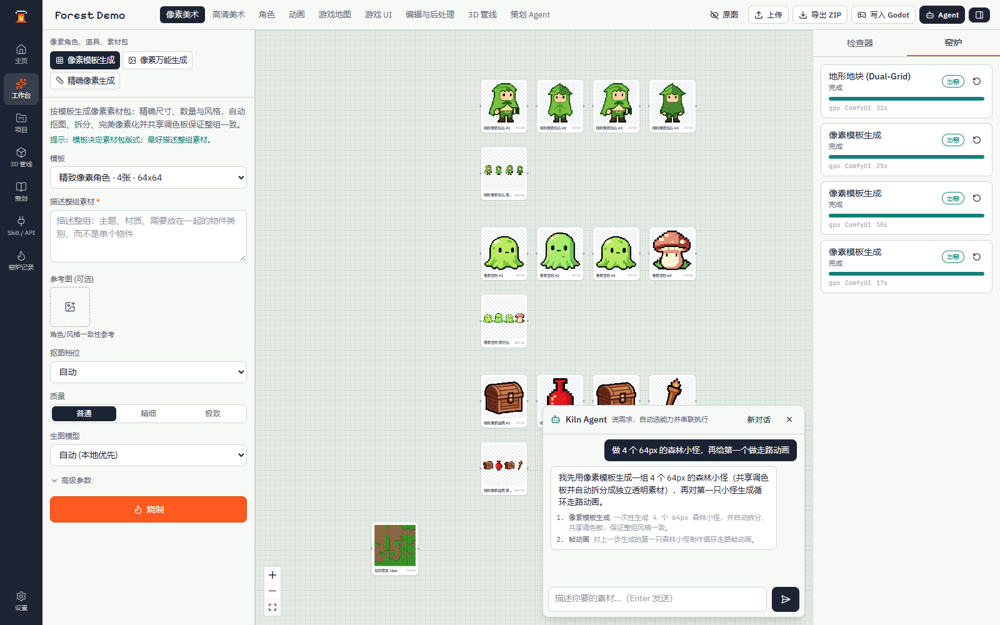
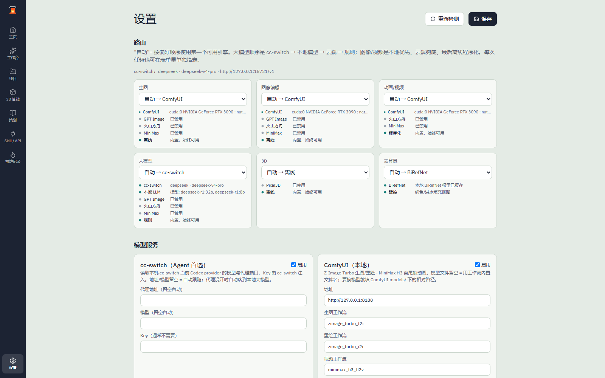
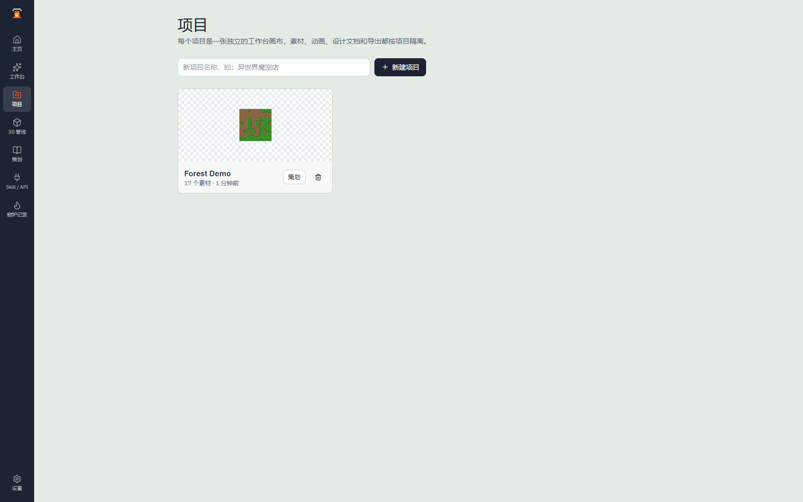

# SpriteKiln 像素窑

本地优先的 AI 游戏素材工作台。**网页画布 + Skill/CLI + MCP + 内置 Agent** 共用同一套能力目录，用本机模型（ComfyUI Z-Image / MiniMax H3、Pixal3D、Ollama、BiRefNet）或云端模型（GPT Image、Seedream/Seedance、MiniMax）生成游戏素材，并导出到 Godot / Aseprite / Phaser / Tiled。

- 26 个能力：像素、高清、角色多视图、UI、编辑、无缝纹理、双网格瓦片、等角瓦片、横版视差、帧动画、关键帧动画、视频、3D、策划文档
- 三级路由：本地优先 → 云端兜底 → 离线程序化兜底；任何一环没配好都不会让流水线停摆
- Agent 首选本机 cc-switch（自动跟随其当前 Codex provider，Key 不落地），没开时用本地 Ollama，再退云端/规则；对话中实时显示模型的思考过程
- 产物即工程文件：Sprite Sheet、GIF/WebP、Godot SpriteFrames/.tscn、Aseprite JSON、Phaser atlas、Tiled `.tsj`
- 质量门控：动画逐帧检查空帧/面积波动/尺寸漂移/重复帧，不通过自动换 seed 重拍
- 批量：JSON manifest 一次产出整套素材，写 `batch_report.json`
- 单用户、本机运行；本地版 AGPL-3.0 开源，托管服务独立私有（[边界说明](docs/10-开源与商业边界.md)）

> 当前版本是 1.0.0。项目较新，导出格式有测试覆盖，但尚未在真实引擎里做运行级验证；公网商用前请先读 [部署与安全边界](docs/08-开源自托管与商用部署.md)。

---

## 快速开始

### Windows（推荐）

需要 **Python 3.10+**；构建前端需要 **Node 18+**。

```powershell
git clone https://github.com/sealeee/spritekiln.git
cd spritekiln

py -3 -m venv .venv
.\.venv\Scripts\Activate.ps1
pip install -r backend\requirements.txt

.\start.ps1 -NoComfy     # 第一次先不启 ComfyUI，用离线引擎把流程跑通
```

打开 <http://127.0.0.1:7788>。

- `.\start.ps1`：ComfyUI 没运行时会尝试在新窗口启动它（需要设置 `COMFYUI_DIR`）
- `.\start.ps1 -Build`：重新构建前端
- `.\start.ps1 -Port 7799`：换端口

### macOS / Linux

```bash
git clone https://github.com/sealeee/spritekiln.git
cd spritekiln
python3 -m venv .venv && source .venv/bin/activate
pip install -r backend/requirements.txt
cd web && npm ci && npm run build && cd ..
python backend/run.py --host 127.0.0.1 --port 7788
```

### Docker（CPU）

```bash
docker compose up --build
```

镜像包含 API 与已构建前端，不含 GPU 模型。ComfyUI / Pixal3D 仍在宿主机运行，通过 `host.docker.internal` 访问。

### 零配置也能跑

没有 ComfyUI、没有云端 Key 时，路由会自动落到 `mock` / `procedural` / `rules` / `chroma`。这适合验证安装、队列、导出和 CI；产物是占位图，不是最终美术。

---

## 界面预览

<table>
  <tr>
    <td width="50%"><b>首页</b> — 能力入口与实时引擎状态<br></td>
    <td width="50%"><b>工作台</b> — 画布 + 能力参数 + Agent 对话<br></td>
  </tr>
  <tr>
    <td width="50%"><b>设置</b> — 路由与模型服务（大模型首选 cc-switch）<br></td>
    <td width="50%"><b>项目</b> — 素材、动画、导出按项目隔离<br></td>
  </tr>
</table>

截图来自本机 ComfyUI（Z-Image Turbo + MiniMax H3）真实生成的项目，不是效果图。设置页的「大模型 → 自动 → cc-switch」后面就是 cc-switch 当前选中的 provider 与模型名。

---

## 配置模型

所有配置都在网页 **设置** 页，保存到 `data/settings.json`（API Key 明文，已 gitignore；返回浏览器时掩码）。

| 想做什么 | 配哪里 |
|---|---|
| 本地生图/动画 | ComfyUI 地址 + 工作流名 + 模型文件名；按 [模型清单](docs/07-模型配置.md#32-需要哪些模型) 放置权重 |
| Agent 规划 | 首选 cc-switch（自动跟随其当前 Codex provider）；没开时用本地大模型（Ollama / LM Studio）或云端 LLM |
| 云端生图/视频 | OpenAI / 火山方舟 / MiniMax 的 Key 与图像/视频/对话模型名 |
| 单图转 3D | Pixal3D 仓库目录 + 独立 venv 的 Python |
| 神经抠图 | `pip install torch …` 并预下载 `ZhengPeng7/BiRefNet` |

环境变量模板见 [`.env.example`](.env.example)。优先级：`data/settings.json` > 环境变量/`.env` > 内置默认值。

**关于 cc-switch**：Agent 的**首选**模型来源就是本机 cc-switch。它只读 `~/.cc-switch/cc-switch.db` 拿到当前 Codex provider 的模型名和本地代理端口，Key 由 cc-switch 代理自己注入，SpriteKiln 不复制凭据。cc-switch 没运行或代理没开时，自动落到本地大模型，再往后是云端和规则路由。详见 [07-模型配置.md](docs/07-模型配置.md#41-cc-switch首选自动跟随)。

---

## 怎么用

### 网页

打开项目 → 选能力 → 填参数 → 提交。任务异步执行，画布实时刷新（SSE），可以随时接管、收藏、派生、导出。

### CLI / Skill

```powershell
python skills\spritekiln-game-assets\kiln_api.py health
python skills\spritekiln-game-assets\kiln_api.py capabilities
python skills\spritekiln-game-assets\kiln_api.py run pixel_gen `
  --param template=px_char_64 --param "prompt=forest ranger" --output-dir .\out\ranger
```

把 Skill 链接到 Claude Code 的 skills 目录后，可以直接用自然语言驱动；`spritekiln-setup` 负责安装、配置和自检：

```powershell
New-Item -ItemType Junction `
  -Path "$env:USERPROFILE\.claude\skills\spritekiln-game-assets" `
  -Target "$PWD\skills\spritekiln-game-assets"
New-Item -ItemType Junction `
  -Path "$env:USERPROFILE\.claude\skills\spritekiln-setup" `
  -Target "$PWD\skills\spritekiln-setup"

# 不安装 Skill 也可以直接跑自检
python skills\spritekiln-setup\scripts\check_setup.py
python skills\spritekiln-setup\scripts\smoke_test.py
```

### MCP

```powershell
claude mcp add spritekiln -- python "<repo>\mcp\spritekiln_mcp.py"
```

11 个工具：健康检查、能力目录/参数、运行能力、恢复任务、项目/素材、上传、Godot 导出、Agent 对话。

### 批量

```powershell
python skills\spritekiln-game-assets\kiln_api.py batch examples\pack.example.json --output-dir .\out\forest-pack
```

### 内置 Agent

工作台聊天框输入需求，例如「做 4 个 64px 森林小怪，再给第一个做走路动画」。Agent 输出 JSON 计划并逐步执行；LLM 不可用时自动降级为关键词规则路由。

---

## 目录

| 路径 | 说明 |
|---|---|
| `backend/app/` | FastAPI：任务队列、资产存储、Provider 适配、能力、像素算法、Agent、导出 |
| `backend/workflows/` | ComfyUI API 工作流 + 字段/模型映射（`*.map.json`） |
| `backend/tests/` | 离线确定性测试 |
| `web/` | Vite + React 19 + TS + Tailwind 前端 |
| `skills/spritekiln-game-assets/` | Agent Skill + 标准库 CLI（`kiln_api.py`） |
| `skills/spritekiln-setup/` | 安装/配置自检 Skill |
| `mcp/spritekiln_mcp.py` | stdio MCP server |
| `tools/` | ComfyUI / Pixal3D 的 Windows 辅助脚本 |
| `docs/` | 使用、模型配置、部署、同类项目对比 |
| `data/` | 运行时数据（SQLite、素材、设置；gitignored） |
| `examples/` | 批量 manifest 示例 |

---

## 测试

```powershell
python -m pytest backend/tests -q     # 23 passed，离线、无 GPU
cd web; npm run build                 # 前端类型检查 + 构建
```

CI 在 GitHub Actions 上跑同样的两步。

---

## 文档

- [01-技术分析](docs/01-技术分析.md)
- [02-实现设计](docs/02-实现设计.md)
- [03-3D 管线](docs/03-3D管线.md)
- [04-产品大纲与二开路线](docs/04-产品大纲与二开路线.md)
- [05-对齐验证报告](docs/05-对齐验证报告.md)
- **[06-本地化使用说明](docs/06-本地化使用说明.md)** — 一步一步安装与使用
- **[07-模型配置](docs/07-模型配置.md)** — ComfyUI / Ollama / 云端 / Pixal3D / BiRefNet
- **[08-开源自托管与商用部署](docs/08-开源自托管与商用部署.md)** — Docker、反代、安全清单
- **[09-同类项目对比](docs/09-同类项目对比.md)** — 与 pixel-art-factory、agent-sprite-forge 等的区别
- **[10-开源与商业边界](docs/10-开源与商业边界.md)** — 哪些开源、哪些是托管服务、CLA 与商业许可

---

## 安全与商用

- 默认只监听 `127.0.0.1`，**没有登录、租户隔离、限流**；不要直接暴露公网。
- `data/settings.json` 含明文 API Key；`/api/settings` 可读可写，`/files` 直接暴露素材。
- 公网/商用前必须补：认证、CORS 收紧、租户隔离、Postgres + 外部队列、对象存储、配额与审计。完整清单见 [08](docs/08-开源自托管与商用部署.md) 与 [SECURITY.md](SECURITY.md)。
- 模型权重、LoRA、字体、示例素材各有许可证；商用前逐项确认。

---

## 与同类项目的区别

| 项目 | 定位 | SpriteKiln 的差异 |
|---|---|---|
| [pixel-art-factory](https://github.com/RosemyneH/pixel-art-factory) | 本地 SDXL 像素素材工厂 | 不绑定单一模型；有工作台、Agent、3D；汲取了 JSON manifest 批量 |
| [agent-sprite-forge](https://github.com/0x0funky/agent-sprite-forge) | 主静帧 → 整套动作 | 本地优先、能力更全；汲取了质量门控/重拍与绝对帧元数据 |
| [sprite-gen](https://github.com/aldegad/sprite-gen) | 底图 → atlas/循环动画 | 可从提示词开始，也能接底图；同样做循环与帧检查 |
| [game-asset-mcp](https://github.com/MubarakHAlketbi/game-asset-mcp) | MCP 程序化像素/3D | 生成模型追求更高风格上限，同时保留确定性兜底 |

完整对比、汲取点与测试证据见 [09-同类项目对比.md](docs/09-同类项目对比.md)。

---

## 参与贡献

见 [CONTRIBUTING.md](CONTRIBUTING.md)。提交前请跑测试与前端构建，不要提交 `data/`、`.env` 或个人绝对路径。

## 许可

本地版以 **[AGPL-3.0](LICENSE)** 开源：自己用、商用产物、自建内部服务都没问题；把修改后的代码作为网络服务提供给别人时，需要向使用者提供对应源码。

如果你的公司需要**闭源嵌入**或不想承担 AGPL 义务，可申请 [商业许可](LICENSE-COMMERCIAL.md)。MIT 时期（v1.0.0 之前的提交）仍按 [MIT](LICENSE-MIT) 授权。

托管服务（账号、计费、多租户、GPU 调度）不在本仓库，见 [开源与商业边界](docs/10-开源与商业边界.md)。

外部贡献需要签署 [CLA](CLA.md)。

---

<details>
<summary>English</summary>

SpriteKiln is a local-first AI game-asset studio. A web canvas, a standard-library CLI/Skill, an MCP server and a built-in agent share one capability catalog (26 capabilities) covering pixel/HD art, characters, UI, tilesets, parallax maps, animation, 3D and design docs. Generation runs on local ComfyUI (Z-Image Turbo, MiniMax H3), Pixal3D, Ollama and BiRefNet, with optional cloud providers (GPT Image, Seedream/Seedance, MiniMax). The built-in agent prefers the local cc-switch proxy (following whichever Codex provider is selected) and falls back to Ollama, cloud LLMs and rule-based planning. Every model name — image, video, LLM and ComfyUI weight files — is editable in Settings. Outputs ship as sprite sheets, GIF/WebP, Godot SpriteFrames, Aseprite JSON, Phaser atlases, Tiled tilesets and ZIP packs.

Quick start: `pip install -r backend/requirements.txt`, build `web/` with `npm ci && npm run build`, then `python backend/run.py`. Without local models or cloud keys the router falls back to deterministic mock/procedural engines. Docs are currently in Chinese; start with [docs/06](docs/06-本地化使用说明.md) and [docs/07](docs/07-模型配置.md).

</details>
