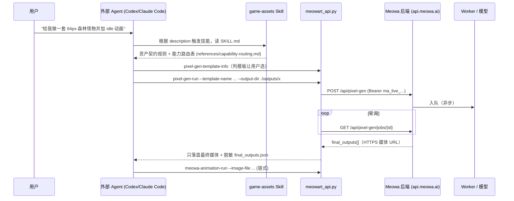

# 01 · meowa.ai 产品与技术分析

> 调研时间：2026-10。资料来源：meowa.ai 网页实测（浏览器遍历首页 / 画布 / Skill 页 / API 文档入口）、官方开源 Skill 仓库
> [Meowa-AI/meowa-skills](https://github.com/Meowa-AI/meowa-skills)（`SKILL.md`、`references/*.md`、`meowart_api.py`、`web_parameter_contract.json`）、
> 首页内嵌遥测脚本暴露的路由分类，以及 PixelLab / Retro Diffusion / Scenario / Ludo 的公开资料。
> 标注：**[实测]** 为直接观察或代码/文档原文；**[推断]** 为基于证据的推测。

## 1. 产品形态

### 1.1 定位
"Meowa – 做游戏，从此更简单"。面向独立开发者与小团队的 **AI 游戏美术 + 音频 + 策划 工作台**，中英双语，国内/海外双存储线路
（`media-cn.meowjito.com` / `media.meowa.ai` + GCS）[实测]。新用户赠 200 积分、日送 10 积分，积分按质量/分辨率/参考图数计费 [实测]。

### 1.2 信息架构 [实测]

| 入口 | 路由 | 说明 |
|---|---|---|
| 主页 | `/` | 6 张启动卡：像素美术、高清美术、音乐音效、策划 Agent、游戏 UI、游戏地图 |
| 创作工作区 | `/canvas?launch=<pixel-asset-pack \| asset-pack \| music \| ui-agent \| map-editor>` | 无限画布 + 左侧能力面板；`launch` 决定默认打开的模块 |
| 策划 Agent | `/game-design` | 生成持久化 Markdown 设计文档 |
| Skill | `/agents` | `npx skills add https://github.com/Meowa-AI/meowa-skills --skill game-assets`；兼容 Codex/Claude/Cursor/Windsurf/Manus 等 |
| 教程 / API 文档 / 价格 / 作品 / Meowa 游戏 | `/tutorial` `/api-docs` `/pricing` `/gallery` `/games` | |
| 顶栏 | 收藏、历史记录、积分、素材线路(自动/国内/海外)、语言 | |

### 1.3 模块与参数（摘自 web_parameter_contract.json 与 references）[实测]

| 模块 | 能力 | 关键参数 / 契约 |
|---|---|---|
| 像素美术 | **模板生成** `pixel-gen`（精致像素角色/道具/武器/食物…，"8 张 · 64px" 等固定契约）、**万能生成** `pixel-universal`（4:3 xlarge 画布、standard/top-down）、**精确像素** `custom-size-pixel`（任意宽高单物件）、大尺寸像素 | 分辨率筛选、抠图档位(none/standard/advanced)、方向、参考图 |
| 高清美术 | `hd-gen`（角色 2×2、素材包 4×4，Image2.5/Standard/1K）、**通用生成** `general-image`（image-2.5 / image-2 / nano-banana，1K/2K，1:1…16:9，质量 普通/精细/极致） | 参考图每张 +2 积分；Image2.5 原生透明免费 |
| 角色 | `character-multi-view`（八方向：五视图+镜像或九宫格；pixel/hd；1K/2K） | 左右视图通常镜像 |
| 编辑 | 去背景（静态/动画逐帧，batch 2/4/8/16）、像素化、万能编辑（遮罩局部重绘、多参考、分区/多重像素化）、一键升级/变体、素材克隆（1/4/9/16/25/36 宫格）、动画帧编辑、拼豆、Spine 换皮/部件编辑 | |
| 地图 | 64×64 纹理检索/生成、等角纹理、**Dual-Grid 地块**（前景/背景/双纹理，4×4 图集）、等角/六角等角地块（128×64 菱形，邻格偏移 (64,32)；hex 步长 127）、HD 等角(372/119)、横版三层视差、图像扩展 | 1000+ 内置地图参考 |
| 动画 | **V2 `meowa-animation`**（默认 16 帧 / Pixel / 480P，8/16/24/32 帧，loop/non-loop，尾帧，quality standard/medium/advanced，透明 soft/sharp，自动缩放回输入尺寸）、V1 `animate`（pixel-engine-v1.1 / frame-engine-v1.1，适合简单 idle/walk）、**关键帧** `keyframes`（6–20 帧，每关键帧 strength）、视频（Seedance 生成器，首帧/首尾帧）、参考视频动画编辑 | 动画 padding 上限 256/320px；像素角色建议 ≤128² |
| 音频 | 音效/音效包、音乐（MiniMax Music）、TTS / 声音克隆 | |
| 策划 | `game-design-run`：调研、GDD、数值、批判性评审 → Markdown 文档树 | 按 token 实时计费 |
| 游戏开发(内测) | TypeScript/Three.js 隔离工作区：创建/运行/预览/导出/发布 | **非 Godot** |

## 2. "Skill + Agent" 机制 [实测 + 推断]

1. **Skill 定义**：一个目录 = `SKILL.md`（YAML frontmatter `name/description` 用于触发；正文是"契约优先、最小能力、何时串联"的操作规则）
   + `references/` 按能力族拆分的长文档（按需加载，控制上下文）+ 版本化 CLI `meowart_api.py`（≈520KB，含所有命令、默认值、
   安全检查）+ `web_parameter_contract.json`（网页参数 ↔ CLI 参数 ↔ 请求字段的单一事实源）+ `agents/openai.yaml`（Codex UI 元数据）。
2. **触发逻辑**：Agent 依据 frontmatter description 匹配用户意图 → 读 SKILL.md → 读 capability-routing → 只读所选能力的 reference →
   `<cmd> --help` 获取当前选项 → 执行一个 `*-run`。
3. **调用链路**：CLI → REST（`/api/<family>` 或 `/api/workflows/<id>/run`）→ 服务端隐藏 provider/模型/采样参数（"provider credentials, model
   names, sampling controls, internal workflow stages… are not public parameters"）→ 异步 job → `*-poll` 恢复（严禁重复提交付费任务）。
4. **任务编排**：由外部 Agent 负责，Skill 给出"常见链路"（像素角色：模板生成→编辑→八方向→动画；环境：纹理→地块→地图预览），并强调
   "每一步生成都会改变身份/比例/调色板/成本，避免不必要的串联"。
5. **上下文管理**：渐进式披露（SKILL → routing → 单模块 reference）、CLI `--help` 作为实时 schema、`final_outputs.json` 作为跨步骤状态；
   网页侧以"项目 + 线程(thread)"持久化（`/api/projects/{id}/threads`、`custom-workflow-run --project-id/--thread-id`）。
6. **与 Godot**：官方未提供 Godot MCP 集成 [实测，文档无相关内容]；"自主做游戏"走自家 Three.js 工作区。Godot 自主开发需要我们新建
   （SpriteKiln 提供 Godot 写回 + 社区 Godot MCP）。

## 3. 底层模型 [推断]

| Meowa 名称 | 推断 |
|---|---|
| Image 2.5 / Image 2 | OpenAI GPT Image 系列（Spine 文档直写 "GPT Image 2.5"），原生透明背景 |
| Nano Banana (2.1) | Google Gemini Flash Image；遗留路由名 `/api/gemini/jobs` |
| pixel-engine / frame-engine v1.1、Meowa Animation V2 | 自研/微调的帧动画模型或视频模型 + 后处理（抠图、像素化、帧清理） |
| 视频 | `seedance_generator` → 字节 Seedance |
| 音乐 / TTS | `music_generator`、`elevenlabs_generator`、`meowa_tts`(clone) |
| 抠图 | standard/advanced 两档（推断：键控/BiRefNet 类分割） |
| 像素后处理 | "已完美像素化"：网格检测、调色板量化、孤立像素清理 |

结论：Meowa 的核心价值不在自研基础模型，而在 **"通用大模型 + 游戏资产契约 + 确定性后处理 + 异步编排 + Agent 接口"**。

## 4. 核心技术难点

| 难点 | Meowa 做法 [实测/推断] | SpriteKiln 本地化做法 |
|---|---|---|
| 角色一致性 | 模板参考网格 + 参考图（+2 积分）；多视图走九宫格/镜像；更强一致性走 V2 多视角 32 帧 | 模板整张图一次出组（同批次天然一致）+ **共享调色板量化**；参考图走 GPT Image/Seedream/MiniMax 主体参考；严格一致走 **3D → 渲染 8 方向** |
| 像素网格正确性 | 像素工作流"完美像素化"，禁止二次像素化 | 伪像素块尺寸检测（边缘直方图 + 偏移搜索）→ 块中值还原 → 调色板量化 → 孤立像素清理 → 精确尺寸画布对齐 |
| 关键帧连续性 | V2 首尾帧、keyframes(strength)、帧清理 | 视频模型首尾帧(FL2V)：loop 时尾帧=首帧；关键帧动画按相邻关键帧两两 FL2V 拼接；**键控色舞台**（自动选与精灵不冲突的纯色背景）→ 逐帧键控 → 锁源调色板 → 同一画布保证锚点不跳 |
| 透明背景 | Image2.5 原生透明；标准/高级抠图；动画 batch 抠图 | 纯色键控 + 洪水填充（像素资产精确、零显存）/ BiRefNet（复杂背景）；GPT Image 原生透明 |
| 批量资产与状态持久化 | 项目、线程、历史、收藏、媒体双线路 | SQLite（projects/assets/jobs/messages）+ 文件系统；资产有 parents（血缘）和画布坐标 |
| 异步任务队列 | submit → poll；`*-poll` 恢复 | asyncio 队列，分 **gpu / cloud / cpu** 三条车道（3090 上 GPU 并发=1）；SSE 推送进度；取消/重试；重启后中断任务标记失败 |
| 并发与成本 | 积分体系、质量×分辨率×参考图计价、日赠积分 | 每日云端预算（美元估算）硬限制；本地优先路由；离线引擎兜底 |
| 资产契约 | 模板固定尺寸与数量，"提示词不能改变契约" | 同样以模板 `w/h/count/layout/anchor/colors` 为契约，生成后强制裁切/缩放/量化到契约 |

## 5. 自备模型 API 能否达到同等效果

| 能力 | 可用模型 | 评估 | 差距与替代 |
|---|---|---|---|
| 高清角色/道具/UI | GPT Image 系列、Seedream 4、MiniMax image-01、本地 Z-Image Turbo | **同等**（Meowa 本身就用 GPT Image/Gemini） | Z-Image 无参考图输入 → 用 img2img 兜底；需要强参考时切云端 |
| 像素素材 | 同上 + 确定性像素化 | **接近**：像素网格/调色板由后处理保证；风格多样性取决于提示词 | 后续可训练像素风 LoRA（Z-Image/Flux），或接 Retro Diffusion API |
| 多视角角色 | 生成 5 视图 + 镜像；或 3D 渲染 | 生成式与 Meowa 相当；**3D 路线一致性更强**（几何天然一致） | 3D 路线对细小饰品/发丝不如 2D |
| 帧动画 | 本地 MiniMax H3 FL2V（已部署）、Seedance、Hailuo | **可达到 V2 级别**的动作幅度；H3 本地 ≈4 分钟/段（3090） | 帧数少时动作可能偏小；需人工挑帧（UI 已提供逐帧查看） |
| 关键帧控制 | FL2V 分段插值 | 与 Meowa keyframes 等价（以段为单位） | 无逐关键帧 strength，可通过每段提示词与帧数控制 |
| 地图/地块 | 生图 + 确定性 dual-grid / 等角投影 | 地块拼接正确性 **更强**（程序化保证无缝），风格受纹理质量影响 | 无 1000+ 内置参考库 → 可自建 |
| 音频 | （本机有 ACE-Step、MiniMax music3、index-tts、fish-speech） | 可接入，未纳入本期 2D/3D 范围 | 二期接 ComfyUI ACE-Step 工作流 |
| Spine | — | 未实现 | 二期 |

## 6. 竞品参考

- **PixelLab**：REST v2（create-character 4/8 方向、animate-character、rotate、inpaint、tileset top-down/sidescroller、image-to-pixelart）+ 官方 MCP。
  其"角色对象 + 方向 + 动画"数据模型值得借鉴。
- **Retro Diffusion**：调色板约束像素模型、Pixel Art Fixer、Aseprite 工作流。
- **Scenario**：自训 LoRA 保证品牌一致性（SpriteKiln 二开路线 P1）。
- **Ludo.ai**：一站式 + Unity/Godot 导出 + MCP。
