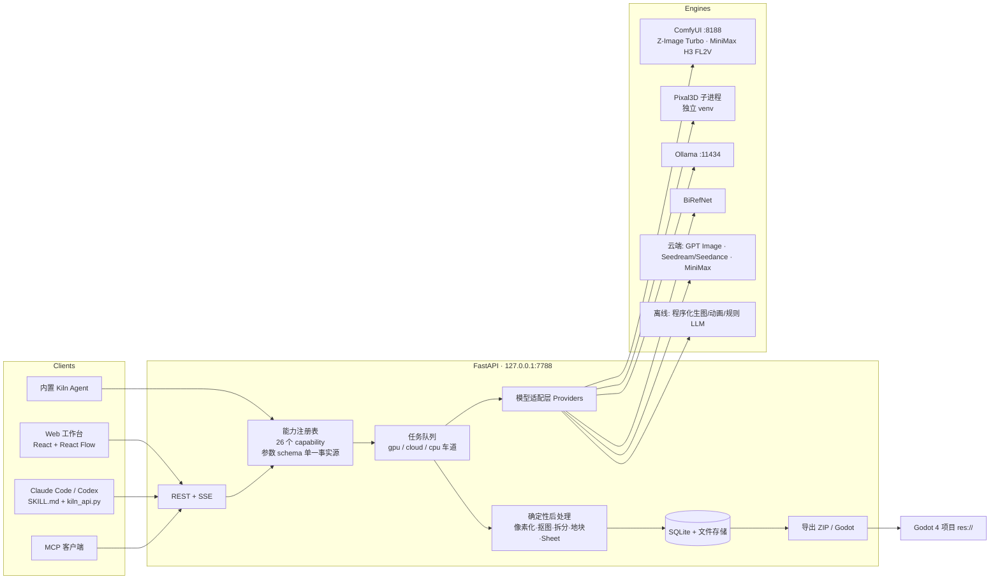
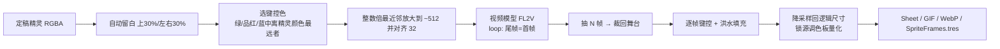

# 02 · SpriteKiln 实现设计

## 1. 总体架构



设计原则：

1. **能力 = 契约**。每个 capability 声明参数 schema（type/default/choices/min/max/advanced），同一份 schema 驱动网页表单、REST 校验、
   CLI 与 MCP 工具描述（对应 Meowa 的 `web_parameter_contract.json`）。
2. **模型只负责"画"，契约由确定性代码保证**：尺寸、数量、透明、调色板、网格、锚点、无缝、帧对齐全部在后处理里强制。
3. **本地优先、云端兜底、离线可跑**：路由 `auto` 取首个健康引擎；无 GPU/无密钥也能用离线引擎跑通全流程（演示/CI）。
4. **资产血缘**：每个资产记录 `parents`，画布用连线展示"源 → 衍生"，导出与 Agent 都基于资产 id。

## 2. 模块设计

### 2.1 后端目录

```
backend/app/
  main.py            REST 路由 + SSE + 静态资源（服务构建后的前端）
  config.py          设置（data/settings.json；密钥掩码返回）
  db.py              SQLite：projects / assets / jobs / messages
  storage.py         文件落盘、画布自动排布、序列化（url / frame_urls）
  jobs.py            JobManager：车道信号量、进度、取消、重试、重启恢复、SSE 广播
  providers/         base.py 接口；comfyui.py；openai_compat.py；cloud.py(Ark/MiniMax)；pixal3d.py；mock.py；__init__ 路由与健康检查
  capabilities/      __init__ 注册表；templates.py 模板契约；common.py 共享步骤；image/edit/map/anim/threed/design_caps.py
  pixel/             pixelate.py · bg.py · split.py · sheet.py · tiles.py
  agent/             Kiln Agent：LLM JSON 规划 / 规则路由兜底 / $prev 串联执行
  export.py          ZIP（含 game-assets.json）与 Godot 写回
backend/workflows/   ComfyUI API 模板 + map.json（字段 → 节点 id/输入名）
```

### 2.2 数据模型

| 表 | 字段 |
|---|---|
| projects | id, name, kind(general/inbox), description, style, viewport, created_at, updated_at |
| assets | id, project_id, kind(image/animation/model3d/doc/video), name, path, width, height, meta(JSON: pixel, palette, prompt, seed, providers, frames[], files{sheet,gif,webp,tres,json}, direction, tile mapping…), parents[], job_id, capability, x, y, favorite, tags, role(output/raw/pack/preview/input) |
| jobs | id, project_id, capability, params, status(queued/running/succeeded/failed/canceled), progress, message, lane, providers{kind:name}, result[asset ids], error, cost_usd, source(web/cli/mcp/agent), 时间戳 |
| messages | id, thread_id, project_id, role, content, data(plan, job_ids, llm) |

### 2.3 API

| 方法 | 路径 | 说明 |
|---|---|---|
| GET | `/api/health` | 各引擎健康 + 当前自动路由 |
| GET/PUT | `/api/settings` | 设置（密钥掩码） |
| GET | `/api/capabilities` `/api/templates` `/api/comfy/workflows` | 能力目录 / 模板 / 工作流 |
| CRUD | `/api/projects` `/api/projects/{id}` | 项目 |
| GET/POST | `/api/projects/{id}/assets` | 列出 / 上传 |
| GET/PUT | `/api/projects/{id}/docs[/{name}]` | 设计文档 |
| POST | `/api/projects/{id}/export` | `{target: zip|godot, asset_ids?, godot_project?}` |
| GET/PATCH/DELETE | `/api/assets/{id}` · `/download?fmt=file|png&scale=|sheet|webp|tres|json|zip` | 资产 |
| POST | `/api/capabilities/{id}/run` · `/api/workflows/{id}/run`（Meowa 兼容形态） | 提交任务，`wait` 可同步 |
| GET/POST | `/api/jobs` · `/api/jobs/{id}` · `/cancel` · `/retry` | 任务 |
| GET | `/api/events` | SSE：job / assets 事件 |
| POST/GET | `/api/agent/chat` · `/api/agent/threads[/{id}]` | Agent |

### 2.4 模型适配层

接口：`ImageProvider.generate/edit`、`VideoProvider.animate(first, last, n, fps)`、`LLMProvider.chat`、`ThreeDProvider.image_to_3d`。

| Provider | 实现要点 |
|---|---|
| ComfyUI | API 格式模板 + `map.json`（`prompt/seed/width/height/image/last_image/length/steps` → 节点输入）；`/upload/image` 上传；`/prompt` 提交；WS 读采样进度；`/history` 取结果；`/view` 下载；取消时 `/interrupt`；3D 前 `/free` 释放显存。新增工作流 = 新增两个 JSON 文件 |
| Z-Image Turbo | t2i 8 步 res_multistep；i2i 用 VAEEncode + denoise（作为无参考模型的参考图兜底） |
| MiniMax H3 FL2V | 首尾帧视频，Turbo LoRA 8 步双时钟采样 + SageAttention 显存补丁；长度规则 `x + (5 - x%17) % 17`（24fps） |
| OpenAI 兼容 | `/images/generations`、`/images/edits`（多参考 `image[]`、遮罩、`background=transparent`）；同一类也服务 Ollama/LM Studio 的 chat |
| 火山方舟 | Seedream `images/generations`（多参考图）；Seedance `contents/generations/tasks`（first_frame/last_frame）轮询 → 抽帧 |
| MiniMax 云 | image-01（subject_reference）；Hailuo `video_generation` + `query` + `files/retrieve` |
| Pixal3D | 独立 venv 子进程 `inference.py --low_vram`，解析 stdout 阶段推进度，SDPA + 离线 HF 缓存 |
| 离线 | 程序化像素精灵（输出“伪像素”以覆盖网格检测）、变换动画（idle/walk/attack/jump/float/spin/hurt/bounce）、规则 LLM、Billboard GLB |

### 2.5 关键流水线

**像素模板生成 (`pixel_gen`)**：模板提示词（类别 + 网格布局 + 白底 + 像素风）→ 生成整张 → 抠图 → 连通域拆分（数量不符时退化到网格切分）
→ 整张图检测伪像素块 → 全组提取共享调色板 → 每个部件按模板 `w×h/anchor` 适配并量化 → 原图(raw) + N 个输出 + 素材包预览(pack)。

**帧动画 (`animate`)**：

**关键帧动画**：关键帧统一画布（底部对齐）→ 相邻关键帧两两 FL2V → 拼接去重复帧 → 统一调色板。

**3D → 2D**：Pixal3D GLB → 浏览器 three.js 以固定俯角按 8 方向渲染（可卡通着色）→ `render_sprites` 统一尺度 + 共享调色板 + 底部锚点。

## 3. 前端交互

- **主页**：本地引擎状态条（实时健康）、6 个入口（与 Meowa launch 参数一一对应）、最近项目。
- **工作台**（`/studio/:pid?launch=`）：顶栏模块切换；左侧能力表单（schema 驱动，基础/高级参数，素材选择器支持上传与多选排序）；
  中间 React Flow 无限画布（拖拽上传、血缘连线、框选多选、原图显隐、小地图）；右侧 **检查器**（整数缩放、调色板、逐帧、下载、
  继续加工快捷操作）/ **窑炉**（任务架：从青釉色升温到余烬橙的进度条、取消/重试、引擎与耗时）；浮动 **Kiln Agent** 对话（选中素材自动作为附件）。
- **3D 管线**：生成表单 + GLB 查看器（朝向/俯角/卡通着色/方向数/精灵尺寸）→ 一键渲染方向精灵。
- **策划**：文档列表 + Markdown 预览/编辑 + 生成表单。
- **Skill / API**：安装命令、MCP 配置、CLI 示例、可展开的能力参数表。
- **设置**：每类任务的路由与健康、各模型服务配置（密钥掩码）、云端预算、并发车道、Godot 路径。

视觉语言：切割垫网格（8/64px）作为画布底；墨蓝 #1C2333 + 余烬橙 #FF5A1F + 琥珀 #F2B134 + 青釉 #157F7A；
Pixelify Sans 仅用于标题/品牌，正文 IBM Plex Sans，数据 JetBrains Mono。

## 4. Skill / Agent 编排

| 层 | 内容 |
|---|---|
| Skill (`skills/spritekiln-game-assets`) | `SKILL.md`：健康检查 → 选项目 → 定资产契约 → 路由一个主能力 → `describe` 看 schema → 运行/轮询恢复 → 验证 → Godot 交付；`references/capability-routing.md`、`references/godot.md`；`kiln_api.py`（标准库，图片参数可传本地路径自动上传，只下载最终产物 + `final_outputs.json`） |
| MCP (`mcp/spritekiln_mcp.py`) | stdio JSON-RPC：health, list/describe_capability, run_capability(含缩略图), get_job, projects, assets, upload, export_godot, agent_chat |
| Kiln Agent | LLM（本地 deepseek-r1 / 云端）按能力目录输出 JSON 计划；`$prev`/`$stepN` 引用前一步产物；后台顺序执行并把进度写回对话；无 LLM 时关键词规则路由（含"先生成再动画"自动补链） |
| Godot | 导出写入 `res://assets/spritekiln/<project>/`：PNG、sheet、SpriteFrames、AnimatedSprite2D 场景、manifest，并设置最近邻过滤；godot-ai MCP 负责场景摆放 |

## 5. 本地运行与商用路径

| 路径 | 方案 |
|---|---|
| 本地个人 | `start.ps1`：FastAPI + 构建好的前端 + 自动拉起 ComfyUI；SQLite；单 GPU 车道 |
| 小团队内网 | `--host 0.0.0.0`；ComfyUI 多机（provider 支持多个 base_url 的扩展点）；共享 data 目录或换 Postgres |
| 商用 SaaS | 需要：账号/鉴权（API Key 如 `ma_live_` 形态）、计费积分、对象存储 + CDN（国内/海外双线）、Redis/Celery 或云队列、GPU 弹性池（ComfyUI 容器化或 RunningHub/云 API）、内容安全审核、模型许可审查 |

**许可注意**：Z-Image（Apache-2.0）可商用；MiniMax H3 本地权重需核对其许可；Pixal3D/TRELLIS 系列为研究许可或特定条款——商用前逐一确认；
云 API 依各家服务条款。

## 6. 依赖选型

| 层 | 选型 | 理由 |
|---|---|---|
| 后端 | FastAPI + asyncio + SQLite + Pillow/numpy/scipy + PyAV + trimesh | 本机已有，零额外安装；异步适合长任务轮询 |
| 前端 | Vite + React 19 + TS + Tailwind 4 + @xyflow/react + three.js + lucide + marked | 画布与 3D 视图成熟 |
| 本地推理 | ComfyUI（Z-Image、MiniMax H3、Wan2.2、LTX、TRELLIS2…） | 已部署，工作流即插件 |
| 3D | Pixal3D（独立 venv 子进程） | 与 ComfyUI torch 版本隔离，避免 ABI 冲突 |
| LLM | Ollama OpenAI 兼容接口 | 已有 deepseek-r1 8b/32b |

## 7. 分阶段实施（已完成项打 ✅）

| 阶段 | 内容 | 状态 |
|---|---|---|
| P0 骨架 | 后端核心、任务队列、存储、能力注册、离线引擎、前端工作台 | ✅ |
| P1 2D 管线 | 像素/高清/UI/编辑/地图/动画/关键帧，ComfyUI Z-Image + H3 实机打通 | ✅ |
| P2 Agent 接口 | Skill + CLI + MCP + 内置 Agent + Godot 写回 | ✅ |
| P3 3D 管线 | Pixal3D 修复、图/文/多视角→GLB、3D→8 方向精灵 | ✅ |
| P4 品质 | 像素风 LoRA、Qwen-Image-Edit 本地编辑、Wan2.2 补 VAE、多图 3D（TRELLIS.2 / Hunyuan3D-2mv） | 规划 |
| P5 音频/Spine/商用化 | ACE-Step/TTS、Spine、鉴权计费、对象存储 | 规划 |

## 8. 风险

| 风险 | 缓解 |
|---|---|
| 单 3090 显存争用（H3 ~20GB、Pixal3D ~14GB） | GPU 车道并发=1；3D 前 `/free` ComfyUI、卸载 BiRefNet |
| 生成数量与模板不符 | 连通域优先，数量偏多时保留完整个体，不切碎；UI 显示原图便于核对 |
| 视频模型动作幅度小 / 背景漂移 | 键控色舞台 + 锁定相机提示词 + 宽容差洪水填充；提供程序化动画兜底与关键帧动画 |
| ComfyUI 节点版本变化 | 工作流模板与字段映射独立文件，`/object_info` 校验 |
| Pixal3D 依赖脆弱 | `tools/fix_pixal3d.ps1` 幂等修复；子进程隔离 |
| 云端费用 | 每日预算硬限制、本地优先 |
