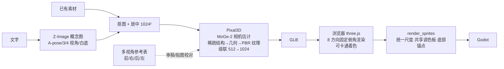

# 03 · 3D 管线（Pixal3D + 3090 优化）

## 1. Pixal3D 本地 bug：根因与修复

在一台 Windows + RTX 3090 上，对本地 Pixal3D 仓库依次复现并修复了四个问题（每次都用 `inference.py` 实跑验证）：

| # | 现象 | 根因 | 修复 |
|---|---|---|---|
| 1 | `ModuleNotFoundError: cumesh` | 独立 venv（torch 2.6+cu124）缺少编译型 3D 扩展；这些扩展的 cu124/torch2.6 预编译版只装在 `ComfyUI\.venv`，而 ComfyUI venv 已升级到 torch 2.11+cu130，ABI 不匹配，所以在 ComfyUI 里也会坏 | 把 `cumesh_vb / flex_gemm_ap / o_voxel / o_voxel_vb_ap / nvdiffrast / nvdiffrec_render / natten` 拷入 Pixal3D venv |
| 2 | 拷入后仍 import 失败 | 预编译包是改名分叉（`cumesh_vb`、`flex_gemm_ap`），Pixal3D 源码 import `cumesh`、`flex_gemm` | venv 中加入 `.pth` 别名钩子（含子模块） |
| 3 | flex_gemm 内核报错 | 需要 triton，独立 venv 未装 | 安装 `triton-windows 3.2`（与 torch 2.6 匹配） |
| 4 | `LocalEntryNotFoundError`（离线） | `pipeline.json` 指定的是**受限仓库** `briaai/RMBG-2.0`（未缓存），而本地缓存的是同架构的 `ZhengPeng7/BiRefNet` | `pixal3d/pipelines/rembg/BiRefNet.py` 先解析本地快照，RMBG-2.0 不在时回退 BiRefNet |
| 5 | `ImportError: einops` | BiRefNet 远程代码依赖 einops/timm | 安装 `einops timm` |
| — | 默认 `ATTN_BACKEND=flash_attn` | Windows 无 flash-attn | 调用时强制 `ATTN_BACKEND=sdpa` |

一键修复脚本：`tools/fix_pixal3d.ps1`（幂等）。验证：`inference.py --low_vram` 输出 36.8 MB PBR GLB；
SpriteKiln 后端端到端（文字 → Z-Image 概念图 → BiRefNet → Pixal3D）用时约 460 s，峰值显存约 12.5 GB。

## 2. 当前管线

`multiview_3d` 先生成四视图参考表用于审稿，再以正视图驱动 Pixal3D；当接入多图输入引擎后，四视图直接作为条件输入。

## 3. 3090 (24 GB) 优化策略

| 策略 | 说明 | 在 SpriteKiln 中 |
|---|---|---|
| 单 GPU 车道 | 任一时刻只跑一个 GPU 任务，避免 H3（~20 GB）与 Pixal3D 同时驻留 | `queue.gpu = 1` |
| 跑 3D 前释放显存 | ComfyUI `/free {unload_models, free_memory}`；卸载 BiRefNet | `Pixal3DProvider` 自动执行 |
| 分阶段加载 (low_vram) | 只在当前阶段把对应 DiT 放到 GPU，其余在 CPU | 默认开启，分辨率 1024 |
| SDPA 注意力 | 替代 flash-attn，Windows 可用 | 环境变量 |
| `expandable_segments:True` | 降低碎片导致的 OOM | 环境变量 |
| 级联分辨率 | 512 粗结构 → 1024 细化；1536 需关闭 low_vram 且独占显存 | `quality=ultimate` |
| 进程隔离 | 3D 依赖与 ComfyUI torch 版本隔离，崩溃不影响主服务 | 子进程 |
| 离线缓存 | `HF_HUB_OFFLINE=1`，避免启动时联网卡住 | 环境变量 |
| 贴图/面数 | GLB 导出阶段 `decimation_target` / `texture_size` 控制体积（游戏用 50–200k 面、1–2K 贴图足够） | 可在 inference 参数中扩展 |

## 4. 业界更先进的工作流（选型建议）

| 方案 | 输入 | 特点 | 3090 可行性 | 本机现状 |
|---|---|---|---|---|
| **Pixal3D**（TencentARC） | 单图 | 像素对齐条件、PBR 纹理、相机估计；几何细节好 | low_vram 1024 ✅ | ✅ 已修复并接入 |
| **TRELLIS.2** | 单图（可多图） | 结构化潜变量 + O-Voxel，几何/纹理质量领先，支持纹理重绘 | 1024 可行，1536 偏紧 | ComfyUI-TRELLIS2 节点已装，可作为第二引擎 |
| **Hunyuan3D-2.1 / 2mv** | 单图 / 多视图 | 形状 + PBR 纹理分离；2mv 直接吃多视图 | 形状 ~10 GB、纹理 ~21 GB，需分步 | ComfyUI 有官方 blueprint，需下权重 |
| **MV-Adapter / Era3D / Zero123++ + LRM (InstantMesh)** | 单图 → 多视图 → 重建 | 先生成一致多视图再重建；可控性强 | ✅ | InstantMesh 仓库在、权重未下载 |
| 3D Gaussian（TripoSplat） | 单图 | 快速预览 | ✅ | ComfyUI blueprint |

推荐演进：**多视角生成（MV-Adapter/Qwen-Image-Edit 多视角提示）→ TRELLIS.2 / Hunyuan3D-2mv 多图重建 → 低模 + 烘焙贴图 → 8/16 方向渲染像素化**。
对于 2D 游戏素材，"3D 作为一致性中间件"比追求高精度模型更重要：几何一致即可保证所有方向、所有动画帧的形体一致。

## 5. 3D → 2D 方向精灵

- 渲染：正交感透视（FOV 30°）、固定俯角（默认 30°，等角游戏可设 35.26°）、8 方向顺时针 S→SE→E→NE→N→NW→W→SW。
- 卡通着色：MeshToonMaterial 保留基色贴图，减少 PBR 高光噪点，像素化后更干净。
- 像素化：所有方向使用 **同一缩放比例**（按最大包围盒）与 **同一调色板**，底部锚点对齐。
- 下一步：骨骼绑定（Mixamo/自动 rig）后在 three.js 播放动作逐帧渲染 → 得到严格一致的 8 方向 × N 帧动画。
